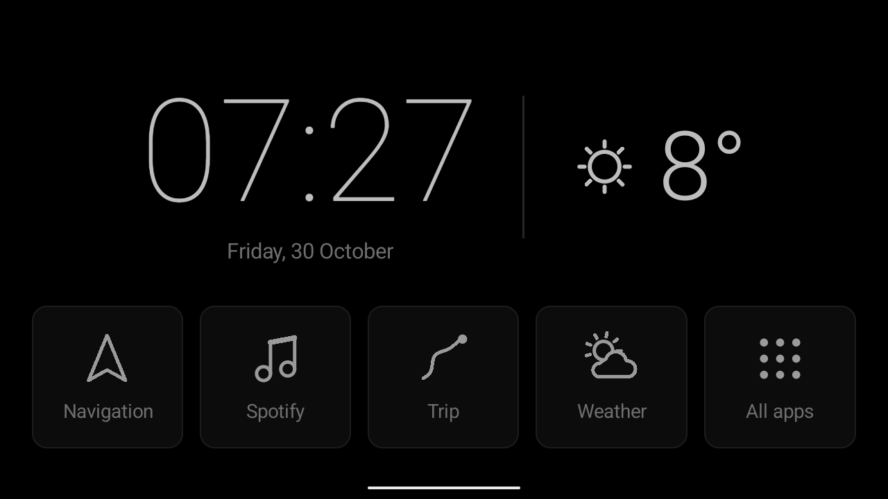
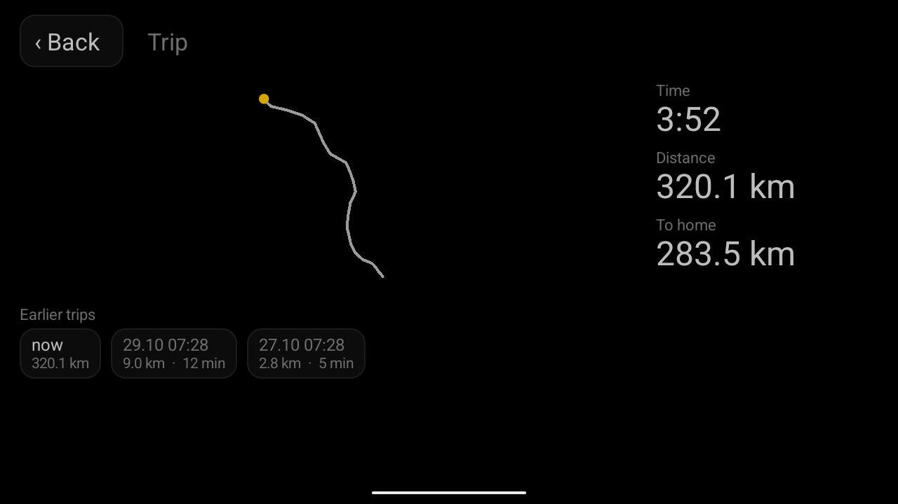
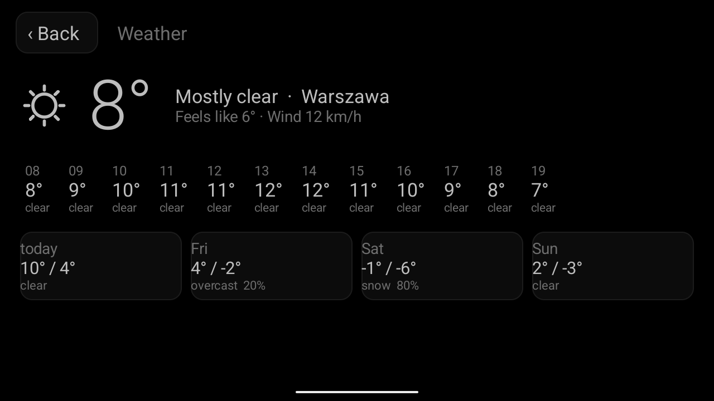
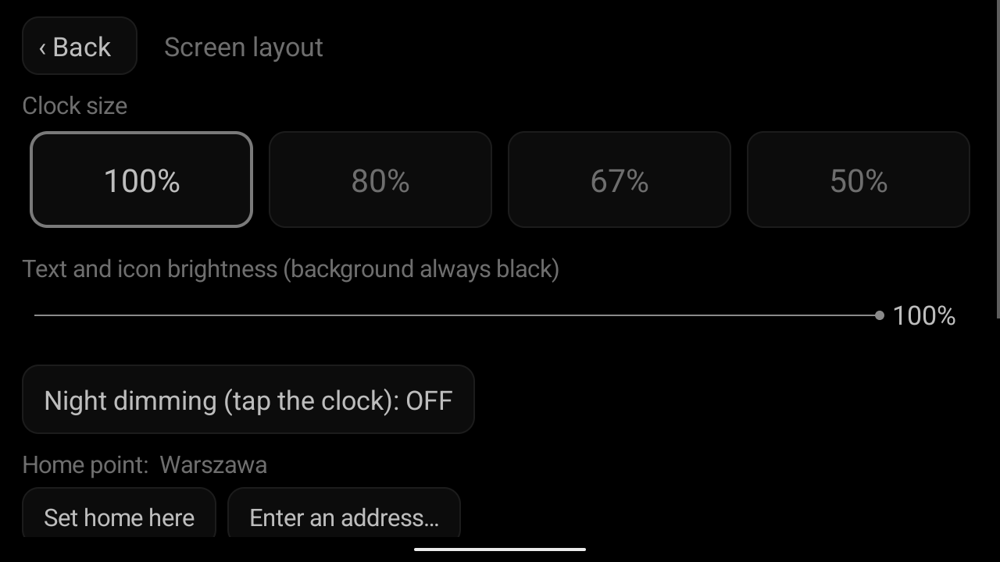

# Navi simple

A minimal, always-black home-screen launcher for aftermarket Android car head units.

The stock launcher on these units is bright, busy and full of animated widgets. This one
shows a clock, the current outside temperature and five large tiles — nothing else. The
background is pure black at all times, and the brightness slider fades only the text and
icons, so the screen never glows white at night.

Built for a Chinese head unit in a Toyota Auris (Android 15, 1280×720 landscape), but it
has no device-specific code and should work on any Android 8.0+ unit.



| Trip | Weather | Settings |
| --- | --- | --- |
|  |  |  |

Every picture in this repository is a real screenshot of the current build, taken on a
1280×720 emulator by the on-device test suite — see [Previews](#previews-and-the-user-guide).
The full illustrated manual is [docs/USER_GUIDE.md](docs/USER_GUIDE.md).

## What it does

- **Pure black home screen** with a thin-font clock, the date, and the outside temperature
  with a line-drawn weather icon.
- **Five tiles**: Navigation, Spotify, Trip, Weather, All apps. The icons are plain grey
  line glyphs drawn in code — no colourful app icons, no brand logos. System settings live
  in the app list rather than on the home row.
- **Built-in weather screen**: current conditions, the next 12 hours and a 4-day forecast,
  in the same black style. Data comes from [Open-Meteo](https://open-meteo.com/) using the
  device location.
- **Black-ice warning**: the temperature turns muted yellow and a warning triangle appears
  when the air temperature is at or below 3 °C, or when freezing rain or drizzle is reported
  now or within the next three hours. This is the same threshold Toyota uses for the
  dashboard snowflake.
- **Other warnings** shown as yellow text under the temperature, for now and the next three
  hours: storm, strong wind (gusts ≥ 70 km/h), dense fog (visibility < 200 m) and heavy snow
  (≥ 1 cm/h).
- **Trip recorder**: time, distance and straight-line distance to a configured home point,
  with the shape of the driven route and a list of earlier trips. A position is stored every
  ten seconds into one CSV file per trip, on the unit and nowhere else.
- **Four size variants** (100% / 80% / 67% / 50%) so the layout fits small or oddly scaled
  screens. All sizes are fractions of the screen height, so density does not matter.
- **Language**: English by default, Polish available, or it follows the head unit's own
  locale.
- **Back and Home always return to the black screen**; the launcher never closes. The unit's
  original launcher is listed first in "All apps" as *Original screen: …*, which is how Radio,
  DAB+ and the car settings stay reachable.

Nothing is fetched while another app is in front. Weather and location refresh every three
minutes while the home screen is visible, and once on every return to it. Offline, the last
cached reading stays on screen. Route recording keeps running regardless, in a foreground
service, because Android throttles location updates for background apps.

## Install

The app is not on Google Play. Install the APK by hand:

1. Download `navi-<version>-debug.apk` from the latest
   [GitHub Actions run](../../actions), or the signed
   `navi-<version>-release.apk` from a [release](../../releases).
2. Copy it onto the unit — USB stick, file manager, local web server or Bluetooth.
3. Tap the APK and allow installation from unknown sources when asked.
4. Open the app, grant location and notification permission, then
   *All apps → Screen layout → Set as default home screen*.

The file name always carries the version, so two downloads can never be confused.

### Going back to the stock launcher

Open **All apps**; the unit's own launcher is the first entry, listed as *Original screen: …*.
To make it the default again, use *Open the system home-screen picker…* in the app, or
Android's *Settings → Apps → Default apps → Home app*.

## Build

Requirements: JDK 21 and the Android SDK (platform `android-35`, build-tools `35.0.0`).
Nothing else — the app has **no dependencies at all**, not even AndroidX, and the APK is
under 100 KB. The test suites do use JUnit and AndroidX Test, but none of that reaches the
shipped APK.

```bash
./gradlew assembleDebug      # app/build/outputs/apk/debug/navi-<version>-debug.apk
./gradlew assembleRelease    # needs signing configuration, see below
```

Either build also renders [docs/navi-user-guide.pdf](docs/USER_GUIDE.md) from the Markdown
guide and the stored previews.

Point Gradle at your SDK with either `ANDROID_HOME` or a `local.properties` file containing
`sdk.dir=/path/to/android/sdk`.

There is also [`build.sh`](build.sh), a Gradle-free path that drives `aapt2`, `javac`, `d8`,
`zipalign` and `apksigner` directly. It reads the same sources and produces the same APK.

### Formatting

```bash
./gradlew spotlessApply      # reformat
./gradlew spotlessCheck      # what CI enforces
```

Java is formatted with google-java-format in its AOSP profile: the Android style, four-space
indents, 100 columns.

## Tests

| Suite | Where | What it covers |
| --- | --- | --- |
| Unit | `app/src/test` | the rules: distances and the route projection, the trip recording logic, the warning thresholds, the number formats, the resource files |
| On-device | `app/src/androidTest` | the user journeys, driven through UiAutomator on a real screen |

```bash
./gradlew testDebugUnitTest          # fast, no device
./gradlew connectedDebugAndroidTest  # needs a 1280x720 device or emulator
```

The split is deliberate. Anything that can be decided without Android — `Geo`, `Trip`,
`Wx`, `Format` and the string resources — is tested on a plain JVM, which is why those
classes take a file or a JSON object rather than a `Context`. Everything that only shows up
on a real screen — Back and Home behaviour, the settings panel scrolling, the foreground
service and its notification, the language switch — is tested on the device.

Neither suite talks to the network or waits for a GPS fix. The weather readings come from
the canned files in [`tools/wx`](tools/wx), regenerated by
[`tools/wx-fixtures.sh`](tools/wx-fixtures.sh); the drives come from `TripFixtures`, which
generates two short town trips and a simulated Warsaw → Gdańsk run along the S7 corridor
(320 km, 3 h 50, a fix every ten seconds) that is shared by both suites.

A debug build accepts intent extras that put it on a given screen with given data
(`navi.screen`, `navi.weather`, `navi.size`, `navi.home`). That is how the tests and the
screenshots get a reproducible screen instead of tapping their way there. A release build
ignores them.

## Previews and the user guide

```bash
./gradlew previews           # overwrite docs/previews from a connected device
./gradlew userGuide          # render docs/navi-user-guide.pdf
```

`previews` installs this build, runs the `ScreenshotTest` journey — every panel, all four
size variants, every warning state, both languages — and copies the results over the stored
previews, so the pictures can never drift away from the code. CI does the same on an
emulator for every push.

The PDF is produced by [`tools/MdPdf.java`](tools/MdPdf.java), a single dependency-free
source file run straight from source by the JDK.

### Signing a release

Release signing material never lives in the repository. Provide it either in a
`keystore.properties` file at the repository root (git-ignored):

```properties
storeFile=/path/to/release.jks
storePassword=…
keyAlias=…
keyPassword=…
```

…or through the `NAVI_KEYSTORE`, `NAVI_KEYSTORE_PASSWORD`, `NAVI_KEY_ALIAS` and
`NAVI_KEY_PASSWORD` environment variables. Without either, `assembleRelease` produces an
unsigned APK.

For CI, store the keystore as a base64 string in the `NAVI_KEYSTORE_BASE64` repository
secret (`base64 -w0 release.jks`) along with the three password secrets. Pushing a `v*` tag
then runs both test suites and publishes a release carrying the signed APK, the user guide
in both formats, a zip of the previews and a `SHA256SUMS.txt`.

> Android only lets you update an installed app with an APK signed by the **same** key. If
> you switch keys, uninstall the old build once first; its settings are lost.

## Project layout

```
app/src/main/AndroidManifest.xml          HOME + LAUNCHER filters, landscape, singleTask
app/src/main/java/pl/matsuo/navi/
    MainActivity.java                     the screens, the weather fetch, the settings
    Trip.java                             trip recording and storage, Context-free core
    TripService.java                      foreground service that feeds Trip
    Geo.java                              distances and the route projection, plain Java
    Wx.java                               warning rules and weather wording, plain Java
    Format.java                           distance and duration formatting
    RouteView.java                        paints a route shape
    Glyph.java                            line icons for the tiles
    WxIcon.java                           weather icon driven by the WMO code and is_day
app/src/main/res/values/strings.xml       English UI text
app/src/main/res/values-pl/strings.xml    Polish UI text
app/src/test/                             unit tests
app/src/androidTest/                      on-device journey tests and the screenshots
app/src/testShared/                       trip fixtures used by both suites
build.sh                                  Gradle-free build
tools/MdPdf.java                          Markdown to PDF, no dependencies
tools/screenshots.sh                      refreshes docs/previews from a device
tools/wx-fixtures.sh                      regenerates the canned weather readings
tools/wx/                                 canned Open-Meteo readings, one per scenario
.github/workflows/build.yml               tests and APK on every push, release on v* tags
docs/USER_GUIDE.md                        the illustrated manual
docs/previews/                            real screenshots, refreshed by the build
```

Settings live in `SharedPreferences("navi")`: `size` (0–3), `bright` (15–100), `dim`,
`lang`, `lat`, `lon`, `weather` (cached JSON), `place`, `home_lat`, `home_lon`, `home_name`.
Recorded trips live in `getExternalFilesDir(null)/trips`, one CSV per trip.

`targetSdk` is deliberately 34, not 35, to avoid Android 15's forced edge-to-edge layout.

## Known limitations

- The temperature is an area forecast, not a road-surface reading. The CAN bus on this unit
  reports "no protocol", so the car's own outside-temperature sensor is unavailable.
- Some head units will not let you change the default launcher without a factory-settings
  toggle.
- Open-Meteo's free tier is for non-commercial use, roughly 10,000 requests a day per IP.
  One car at a three-minute interval uses about 480.
- Recorded trips stay on the unit. Syncing them to Google Drive is not implemented.

## Credits

Weather data by [Open-Meteo.com](https://open-meteo.com/), licensed
[CC BY 4.0](https://creativecommons.org/licenses/by/4.0/).

MIT licensed; see [LICENSE](LICENSE).
