# Navi simple — user guide

Navi simple is a home screen for an Android head unit. It replaces whatever the
unit came with: a black screen with the time, the outside temperature, a warning
line when the road is about to get dangerous, and five large buttons that can be
hit without looking.

Everything else it does — the forecast, the trip recorder, the settings — sits one
tap away and always comes back to that black screen.


This guide covers version 2.2. Every picture in it is a real screenshot of that
build on a 1280×720 head unit screen, taken automatically when the guide is
produced, so nothing here is a mock-up.

---

## What it is for

A head unit screen is a lamp pointed at the driver face. At night a bright
launcher is worse than no launcher at all, and a grid of twenty small icons is
unusable at 90 km/h. Navi simple answers both: the background is pure black and
never anything else, the text is grey rather than white, and nothing on the home
screen is smaller than a thumb.

The second thing it answers is that a cheap unit has no outside thermometer. This
one is reported over the car bus, and on the author unit the bus answers "no
protocol". So the temperature comes from the internet instead, from the position
the unit already knows, and with it come the warnings that matter on a winter
road: black ice above all.

## Requirements

| What | Needs |
| --- | --- |
| Android | 8.0 (API 26) or newer |
| Screen | any; the layout is built from the screen height, landscape |
| Permissions | location (for weather and trip recording), notifications |
| Internet | only for the forecast; everything else works offline |
| Accounts | none. No sign-in, no telemetry, no advertising |

The app has no dependencies of its own: no AndroidX, no Google Play services, no
third-party library. The APK is under 100 KB.

---

# The home screen

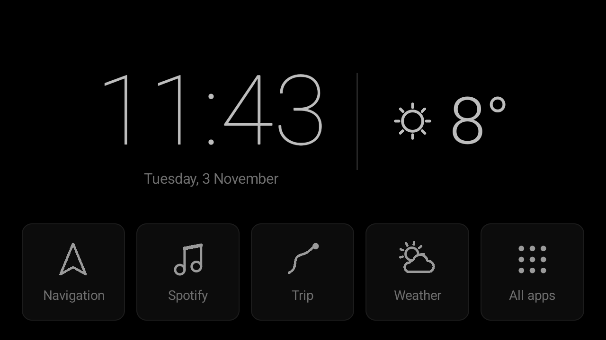

The screen has two halves. The clock and the temperature share the upper half,
five tiles fill the lower one.

## The clock

The time follows the unit 12- or 24-hour setting. Under it is the date in the
language the app is set to.

- **Tap the clock** to dim the screen for night driving, and tap again to undo.
- **Hold the clock** to jump straight to the settings panel.

## The temperature and the warning line

The temperature is the outside temperature at the current position, refreshed
every three minutes from the Open-Meteo service. Tapping it opens the full
forecast.

When the weather needs attention, a warning triangle appears next to the
temperature and a line of warnings appears underneath, in a muted yellow that is
visible at night without dazzling.

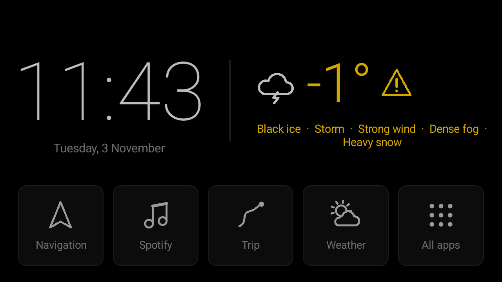

## The tiles

| Tile | What it does |
| --- | --- |
| Navigation | opens the navigation app installed on the unit |
| Spotify | opens Spotify, or the Play Store page if it is not installed |
| Trip | opens the trip screen: time, distance, route |
| Weather | opens the forecast |
| All apps | lists every app on the unit, including the original home screens |

There is deliberately no settings tile. System settings are in the app list, and
the settings of the launcher itself are behind the **Screen layout** button there,
or behind a long press on the clock.

## Going back

Whatever is on screen, both **Back** and the **Home** key return to the black
screen. The launcher can never be closed, and Back on the home screen does
nothing at all — which is the point: nothing the driver presses can leave them
looking at a blank unit.

---

# The weather screen

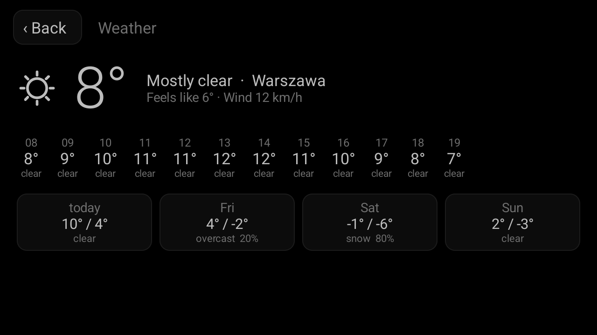

The screen shows, from the top:

- the current conditions: icon, temperature, description, place, what it feels
  like and the wind speed;
- the warning line, when there is one;
- the next twelve hours, each with its temperature and either the chance of
  precipitation or a one-word description;
- the next four days, each with its high and low.

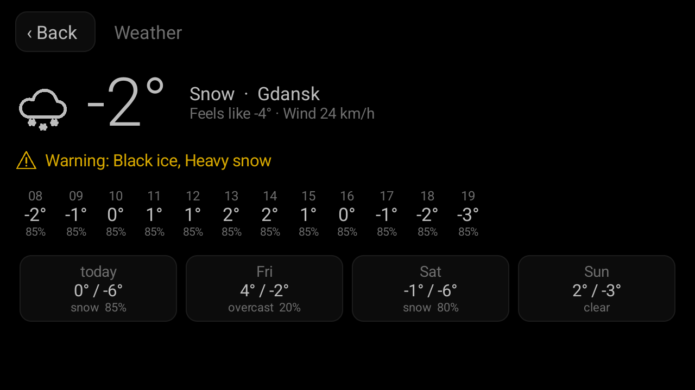

## What raises a warning

A warning is raised for what is happening now or within the next three hours.

| Warning | Raised when |
| --- | --- |
| **Black ice** | temperature at or below +3 °C; or freezing rain or freezing drizzle; or precipitation while the temperature is at or below +3 °C |
| **Storm** | a thunderstorm (WMO code 95 or above) |
| **Strong wind** | gusts of 70 km/h or more, the Polish IMGW first-level alert threshold |
| **Dense fog** | fog reported, or visibility below 200 m within the coming hour |
| **Heavy snow** | heavy snowfall reported, or 1 cm an hour or more |

Black ice is the only one that also recolours the temperature itself, because it
is the one that changes how the car behaves rather than how far the driver can
see.

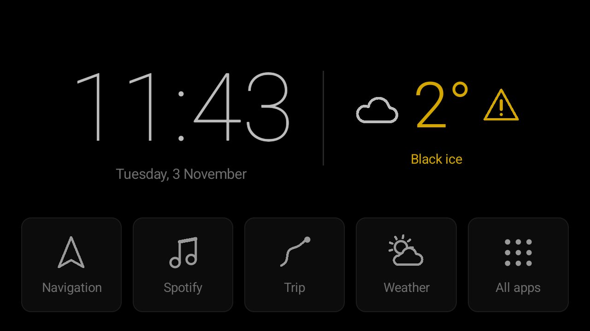

Freezing rain counts even when it is well above freezing right now: the road
surface is what matters, and it is colder than the air.

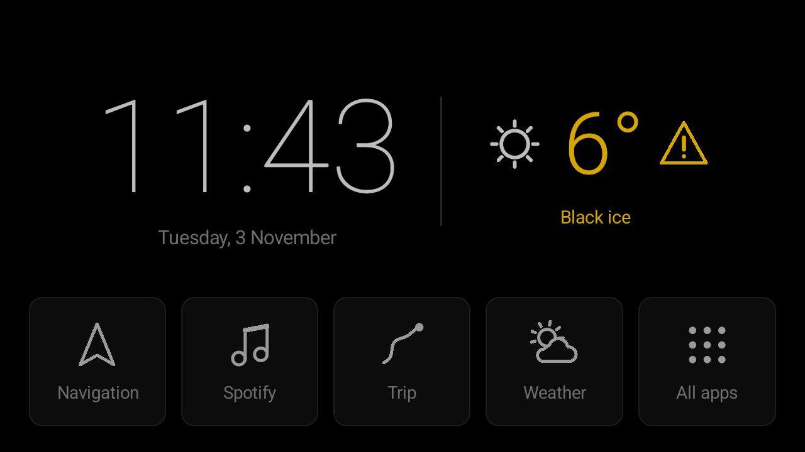

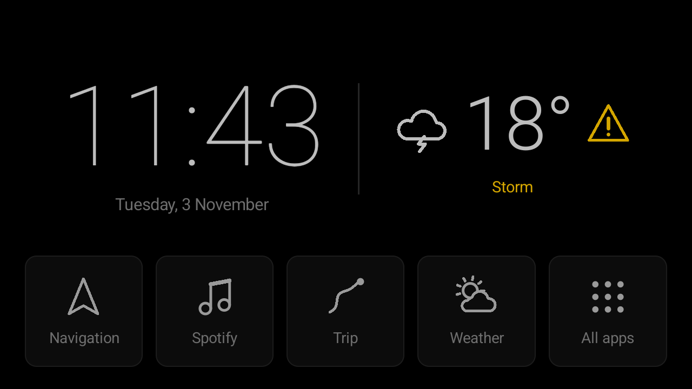

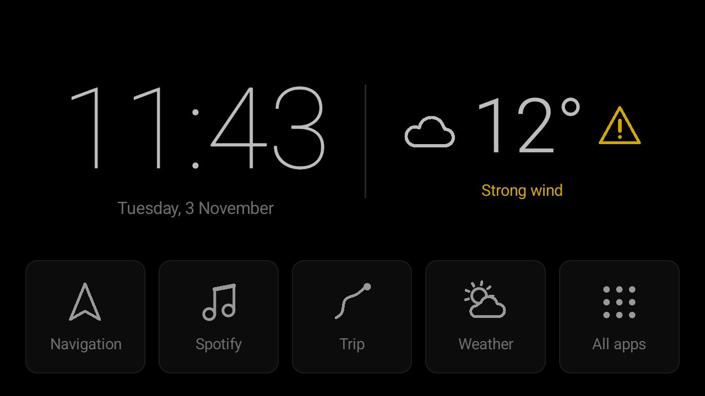

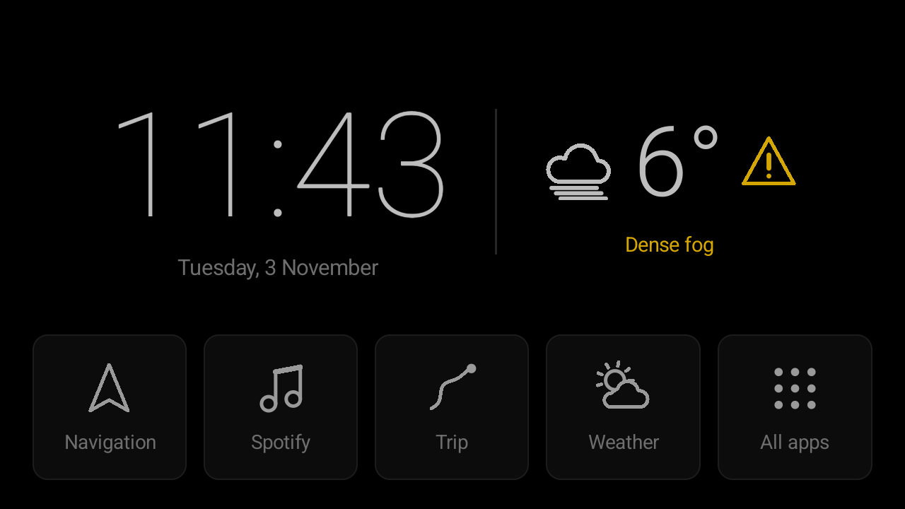

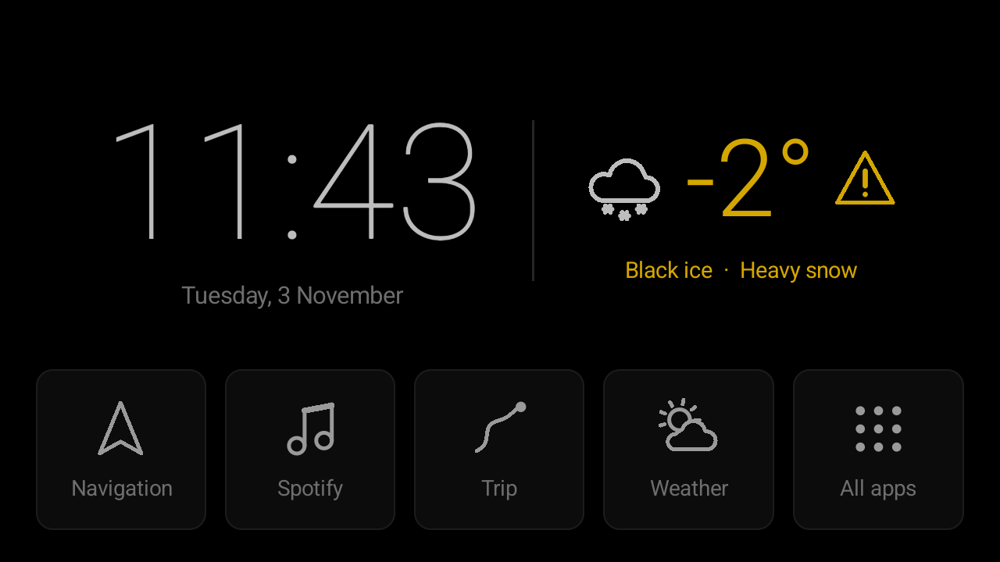

## Where the data comes from

Open-Meteo (open-meteo.com), free, no key, no account, licensed CC BY 4.0. The
only thing sent is a latitude and a longitude rounded to three decimal places.
The last reading is cached, so the screen is never empty after a cold start.

---

# The trip screen

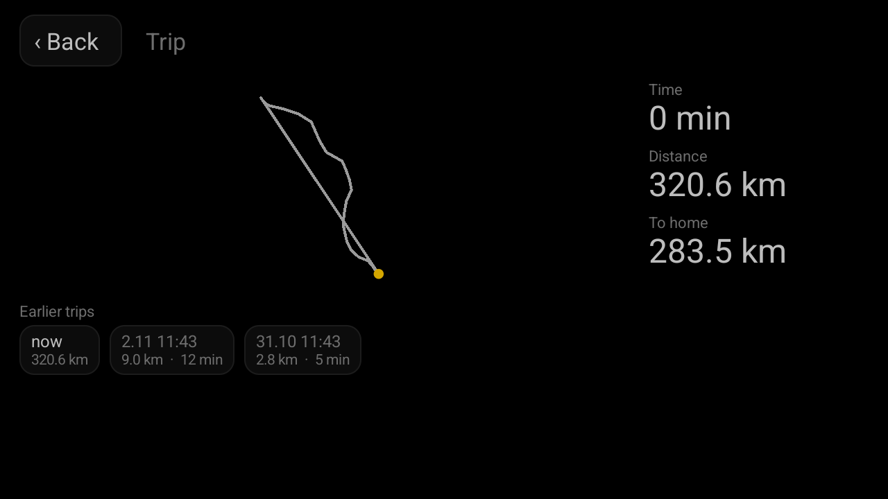

The trip screen answers three questions and draws one picture.

| Figure | Meaning |
| --- | --- |
| **Time** | how long the current drive has been going |
| **Distance** | how far it has gone, along the recorded track |
| **To home** | straight-line distance to the configured home point |

The shape on the left is the route that has been driven. There is no map under it,
no street names, no scale: just the shape, which is enough to recognise a drive at
a glance and reveals nothing if somebody else looks at the screen. The yellow dot
is the latest position.

## Earlier trips

Along the bottom are the recorded trips, newest first, each with its distance and
duration. **now** is the drive in progress. Tapping any of them shows that trip
instead.

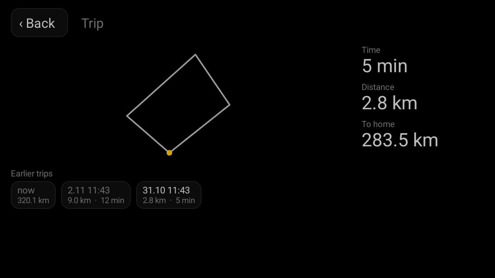

Before the first drive the screen says so rather than showing an empty box.

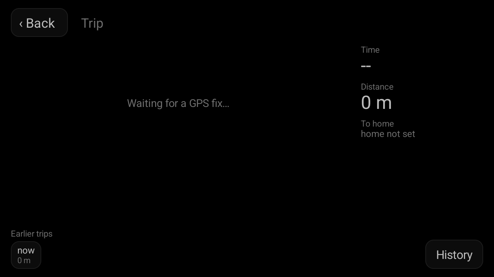

## How recording works

- A position is asked for **every second** while the unit is on; the rate can be set
  to 1, 3 or 10 seconds under Settings → Recording.
- A fix less accurate than 50 m is discarded as noise.
- Movement of less than 5 m is treated as standing still and is not stored, so a
  car parked for an hour does not fill the file with the same point.
- A position that reports its own speed as good as nothing is treated as standing
  still too. At a fix a second a noisy receiver would otherwise walk a parked car
  down the road.
- A jump of more than 2 km between two fixes is a GPS glitch: the point is kept,
  but the distance is not counted.
- **A pause longer than five minutes starts a new trip.** Stopping for fuel keeps
  the same trip; parking overnight starts a new one.
- If the unit restarts mid-drive, the trip is picked up again from disk instead of
  being split in two.

Recording runs in a foreground service, which is why a notification showing the
distance and duration sits in the status bar. Android gives a background app only
a handful of positions an hour, and the recording has to keep working while the
navigation app is in front, so the notification is not optional.

## Where the trips are kept

In a database on the unit, and nowhere else unless you ask for a backup.

Each finished drive is one row holding its summary and its whole route, packed to
about six bytes per recorded position. An hour of driving costs roughly 2 KB, and
a decade of ordinary use stays under ten megabytes. Up to version 1.9 every trip
was a separate CSV file costing thirty-one bytes a position; those files are
imported automatically the first time this version starts, and **kept**, not
deleted — the settings offer to remove them once you are satisfied, and say how
much that would free.

The drive in progress is the exception: it is written a position at a time and
packed when it ends. That is what lets the unit lose power mid-drive and carry on
with the same trip afterwards.

To get a trip out of the unit, use **Export every trip now** in the settings. Each
drive is written as a gzipped CSV — the same `epochSeconds,latitude,longitude` the
old files had — under:

```
Android/data/pl.matsuo.navi/files/export/2026/2026-01-15T07-15-30.csv.gz
```

which a file manager or a USB cable can reach, and which opens in any spreadsheet.

---

# Settings

The settings panel is reached from **All apps → Screen layout**, or by holding the
clock on the home screen.

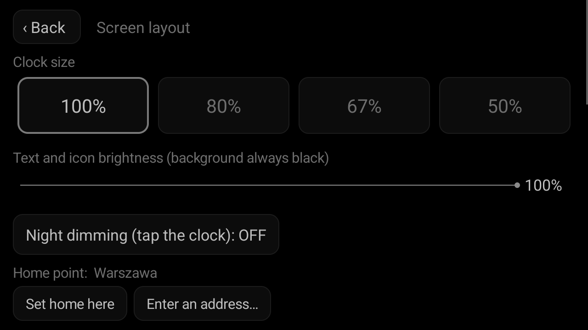

## Clock size

Four sizes, because head units differ and so do eyes. 100 % is the default; the
smaller variants shrink the clock sharply and the rest of the screen gently.


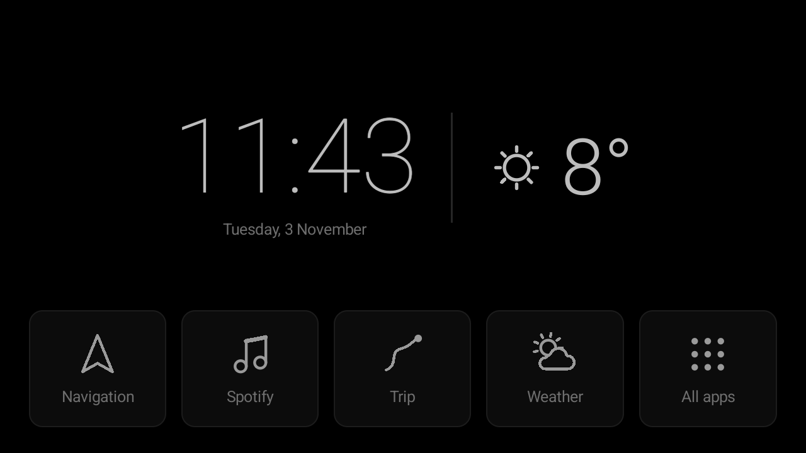

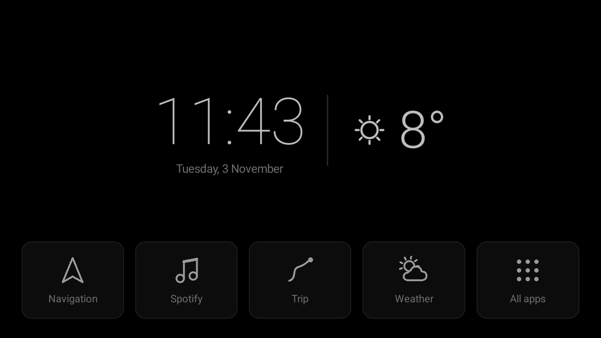

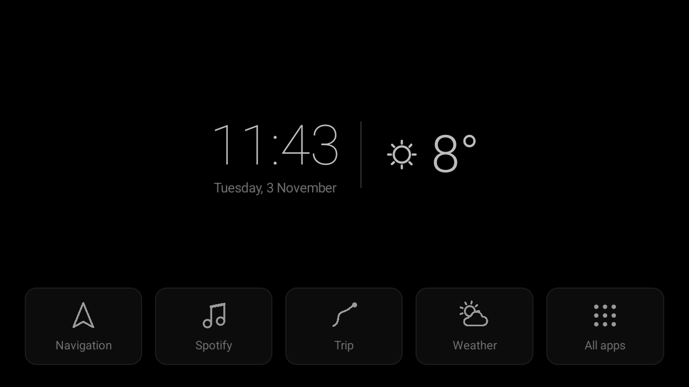

## Brightness

The slider runs from 15 % to 100 % and dims **only the text and the icons**. The
background stays pure black at every setting, which is the entire reason the app
exists.

## Night dimming

A second, deeper level of dimming, toggled by tapping the clock on the home
screen. The switch here says which way it currently is.


## Language

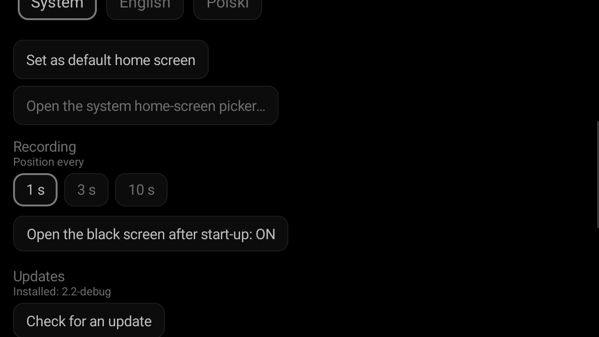

English, Polish, or whatever the unit itself is set to. The choice applies
immediately, including the date under the clock and the order the app list is
sorted in.

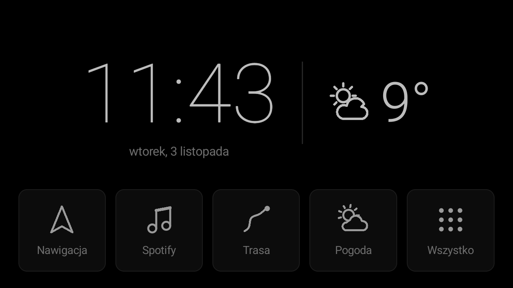

## Home point

The point the **To home** figure measures from. It can be set two ways:

- **Set home here** stores the current position. Fastest, if the car is at home.
- **Enter an address…** looks the address up through the unit geocoder, which
  needs a working internet connection at that moment.

## Set as default home screen

This is the button that makes the unit come up in Navi simple after every ignition
instead of a stock Android screen. On Android 10 and newer it asks the system
directly; on older units, and whenever that fails, it opens the system home-screen
picker instead, which is also available as the second button.

## Recording

**Position every** sets how often the receiver is asked for a position: 1, 3 or
10 seconds. One second is the default. Ten seconds, which earlier versions used,
is nearly three hundred metres between points at motorway speed and visibly cuts
every corner.

A faster rate is not ten times the storage. What reaches the database is still
thinned by movement, so an hour of motorway costs about 20 KB and an hour of town
driving far less.

**Open the black screen after start-up** brings the launcher to the front once the
unit has finished booting.

> This is worth leaving on even if the launcher already comes up by itself,
> because it is also what starts the GPS receiver. A unit parked for a week has
> forgotten where the satellites are and needs anywhere from half a minute to
> several minutes to find them again — if that search only begins when you reach
> the launcher, the first part of the drive is already gone. Switch it off if the
> unit's own screen fights it for the foreground.

## Updates


The app is on no store, so it looks for new releases itself: once a day, and
whenever you press **Check for an update**. If there is a newer one, a dialog asks
whether to install it. A version you say no to is not asked about again.

| What | Meaning |
| --- | --- |
| **Installed** | the version running now |
| **Check for an update** | ask GitHub straight away |
| **Check daily** | whether to look on its own; switched off, only the button checks |

> **An update only installs over the same signature.** Android refuses to replace
> an app with one signed by a different key, which is what stops anyone else
> publishing a counterfeit of it. It also means a release built by the project
> cannot install over a copy built on your own machine — the installer simply says
> it failed. Uninstalling first loses the recorded trips, so export them or switch
> the backup on before changing which key you run.

If the unit will not let the launcher install packages at all, the settings offer
to open the Android page where that is allowed. If it still refuses, the file has
been downloaded regardless and a file manager can finish the job; the message says
where it is.

## Backup

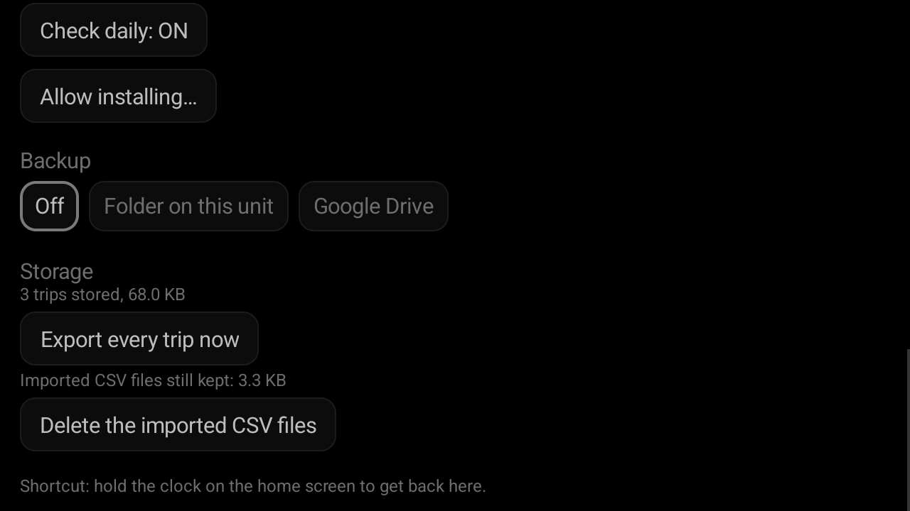

**Off by default, and off means off:** no recorded drive leaves the unit until you
choose otherwise. There are three settings.

| Setting | What happens |
| --- | --- |
| **Off** | Trips stay in the database on the unit |
| **Folder on this unit** | Each finished trip is also written to the export folder, where a file manager or a USB cable can reach it. No account, no network |
| **Google Drive** | Each finished trip is copied to a *Navi simple* folder in your own Google Drive, sorted by year |

Only finished drives are ever copied. The drive in progress is never uploaded, and
a trip is copied once: files are named after the second the drive started, so
there is nothing to merge and nothing to overwrite.

### Signing in to Google Drive

A head unit has no keyboard worth using, so the unit shows a short code and you
type it on your phone: open the address shown, enter the code, approve. The app
asks for the narrowest permission Google offers — it can see only the files it
created itself, not the rest of your drive.

> A build without a Google client configured says so instead of pretending to
> work. The project README explains how to add one; it is not something the app
> can do for you.

### When the backup cannot keep up

Nothing breaks. A failed upload is retried later, waiting longer each time up to
six hours, and the settings line says what went wrong and how many trips are
waiting. **Recording is never affected by any of it**: a backup that is off,
misconfigured, unreachable or refusing to sign in costs an unsynced trip and
nothing else.

## Storage

How many trips are stored and how much room they take. **Export every trip now**
writes every drive to the export folder whatever the backup setting is, which is
the simplest way to get the history onto a stick.

If this unit was upgraded from an older version, the imported CSV files are listed
here with the space they still occupy and a button to delete them. Nothing deletes
them on its own.

> If the launcher is not default, the unit will show its own screen after the
> ignition is switched off and on again. This is the first thing to check if that
> happens.

---

# The app list

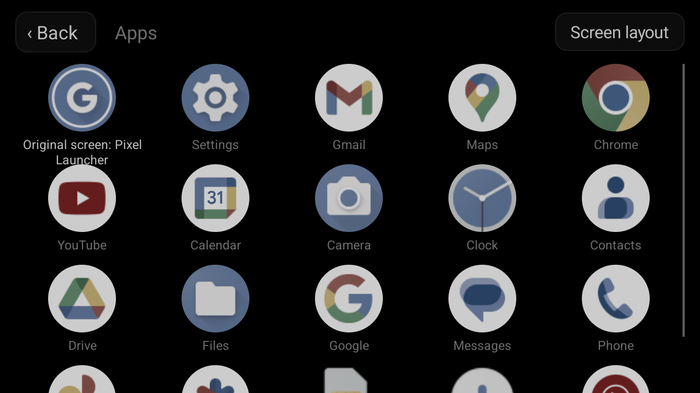

Every launchable app on the unit, sorted by name in the current language. The
original home screens the unit came with are listed first, labelled
**Original screen: …**, so going back to the stock interface is always one tap
away.

The **Screen layout** button in the corner opens the settings described above.

---

# Installing and updating

The APK is not on any store. Install it by hand:

1. Copy `navi-<version>-debug.apk` or `navi-<version>-release.apk` onto the unit —
   over USB, from a file manager, from a local web server, or via Bluetooth.
2. Allow installation from unknown sources when the unit asks.
3. Open the app once and grant location and notification permission.
4. Open **All apps → Screen layout** and press **Set as default home screen**.

Updating is installing the newer APK over the older one. Settings and recorded
trips are kept.

> The file name always carries the version, so two downloads can never be
> confused for one another.

---

# Privacy

- No account, no sign-in, no analytics, no advertising, no crash reporting.
- The only network request is the forecast, to open-meteo.com, carrying a position
  rounded to roughly a hundred metres and nothing else.
- Recorded trips stay on the unit unless backup is switched on, which it is not by
  default. Switched on, they go to your own Google Drive or to a folder on the
  unit, and nowhere else.
- The app asks for location and notifications, and for nothing else.

---

# Troubleshooting

| Symptom | What to do |
| --- | --- |
| The stock screen comes up after the ignition | Settings → **Set as default home screen** |
| The unit's own screen still comes up first after a long park | The ROM starts its own app once Android has booted. Keep **Open the black screen after start-up** on, and look for a power-on or boot-app setting in the unit's factory settings |
| The first minutes of a drive are missing | The receiver had not found the satellites yet. Keep **Open the black screen after start-up** on, so the search begins at boot rather than when you reach the launcher |
| Points are too far apart | Settings → Recording → **Position every**: 1 second |
| The temperature stays blank | Grant location permission; check the unit is online |
| The trip screen shows no route | If it says it is waiting for a fix, the receiver is still searching — after a long park that can take minutes |
| Distance stays at zero while driving | The unit has no GPS fix, or location permission was refused |
| The recording notification is missing | Grant notification permission; Android hides it otherwise |
| Trips are not reaching Google Drive | Settings → Backup: the line there says why. Recording carries on regardless |
| The old CSV files are still on the unit | They are kept on purpose; Settings → Storage removes them |
| The screen is too bright at night | Tap the clock, or lower the brightness slider |
| Text is too small or too large | Settings → Clock size |
| Spotify opens the Play Store | Spotify is not installed on the unit |

---

# Licence and source

Navi simple is MIT-licensed. The source, the build instructions and this guide are
in the project repository. Weather data is from Open-Meteo under CC BY 4.0.
